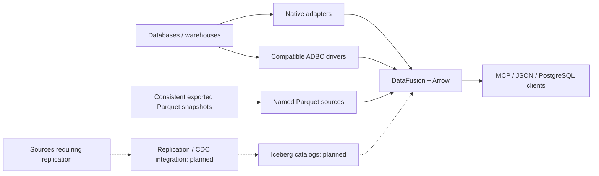

# Broad database connectivity

Igloo's goal is a common SQL and agent interface across databases, warehouses,
and open lakehouse data. Database coverage comes from multiple connector routes;
it does not imply that every database is already supported or certified.

This experimental source update adds generic ADBC federation and named local
Parquet sources. It builds on the agent preview branch
`codex/agent-native-access`; use the revision pinned by the website guide.

## What OLake and Columnar demonstrate

These products address complementary jobs. [OLake](https://olake.io/) documents
replication from PostgreSQL, MySQL, MongoDB, Oracle, Kafka, S3, DB2 LUW and MSSQL
into Iceberg or Parquet on S3. Source databases, destination formats and engines
that can query those formats are distinct compatibility lists. Its advertised
query-engine list is not a list of live database connectors.

[Columnar](https://columnar.tech/) builds on Arrow/ADBC for database access.
[dbc](https://docs.columnar.tech/dbc/) installs drivers for databases and query
engines such as MySQL, SQL Server, Oracle, Snowflake, BigQuery, Databricks,
ClickHouse and Flight SQL. Driver availability and maturity vary. A compatible
driver reduces integration work, but does not certify Igloo against that system.

The [ADBC specification](https://arrow.apache.org/adbc/current/format/specification.html)
defines database access, metadata and Arrow result streams. It does not define
database transaction-log consumption or a portable CDC protocol. Igloo should
reuse this connectivity layer and work with replication systems rather than
confuse querying with replication. Sources reviewed 27 October 2026; vendor
performance claims have not been independently benchmarked here.

## Architecture



All working routes register DataFusion table providers, so joins, agent query
policy, schema discovery and result encoding share one execution path. Native
PostgreSQL keeps its tested pushdown implementation. Generic ADBC conservatively
leaves filters and joins in DataFusion rather than guessing database-specific
SQL semantics. ADBC projection is translated into quoted SELECT column names.

## Coverage and acceptance levels

| Route | Implementation in this preview | Verification |
| --- | --- | --- |
| Native PostgreSQL | Existing catalogs, introspection and selective pushdown | PostgreSQL integration suites |
| ADBC SQLite | Generic C-ABI adapter, metadata discovery and Arrow streaming | SQLite ADBC 1.7.0 on Linux x86_64 |
| ADBC PostgreSQL | Same generic adapter | PostgreSQL ADBC 1.7.0 against PostgreSQL 15; joined to the native connector |
| Named local Parquet | Inferred schemas, multiple named tables and joins | Custom customer/order schema joined to SQLite |
| Other compatible ADBC drivers | Adapter route exists; installation/configuration required | Database-specific compatibility unverified |
| Iceberg catalogs | Planned | Snapshot selection, manifests and delete files not implemented |
| OLake/CDC integration | Planned | No log replication, checkpointing or automatic source freshness |
| JDBC/ODBC-only systems | Planned bridge route | No JDBC/ODBC bridge currently implemented |
| MongoDB and other document/key-value/graph systems | Planned native adapter or correctly read replicated table | No direct MongoDB connector currently implemented |

Candidate ADBC validation targets include MySQL, SQL Server, Oracle, Snowflake,
BigQuery, DuckDB, Databricks, ClickHouse, Redshift, Trino, Presto, Cassandra,
Teradata, SingleStore and Flight SQL services. This is a validation queue, not
a claim that Igloo has tested these drivers, their authentication modes or types.

Inspect the same distinction programmatically:

```sh
./target/debug/igloo connectors
```

MCP clients can call `igloo_connectors`. `igloo_schema` identifies each registered
table's connector route. These report capability and coverage; they do not install
drivers or perform a connectivity check. `igloo schema` initializes the configured
sources and discovers their actual tables.

## Configure a compatible ADBC source

Install a trusted ADBC driver outside Igloo. The current Rust manager loads an
absolute shared-library path using the ADBC 1.1.0 C ABI. It does not automatically
resolve dbc driver manifests. dbc can manage installation; use the driver's setup
instructions to locate its library. Native libraries execute trusted code and
must be configured by the application operator, not chosen from model input.

```toml
[[adbc_sources]]
name = "warehouse"
driver = "/absolute/path/to/the/adbc_driver.so"
# Or supply IGLOO_SOURCE_WAREHOUSE_DRIVER in the process environment.
# Supply IGLOO_SOURCE_WAREHOUSE_URI when this driver uses a URI.
catalog = "analytics"                  # remote database/catalog, if applicable
schemas = ["public"]                   # optional exact allowlist
tables = ["customers", "orders"]      # optional exact table-name allowlist
dialect = "ansi"                       # ansi, mysql, or mssql identifier quoting

[adbc_sources.options_env]
username = "WAREHOUSE_USER"            # environment variable names, not values
password = "WAREHOUSE_PASSWORD"
[adbc_sources.connection_options]
# Put documented connection-level driver options here as string values.
# Supply secrets through connection_options_env instead.
```

ADBC options and authentication are driver-specific. Pass database-level options
through `options` / `options_env`, and connection-level options through
`connection_options` / `connection_options_env`. Environment bindings override
literal options. Option values and URIs are redacted from configuration Debug;
driver errors expose operation and standardized status without vendor messages
that might echo credentials. The adapter does not override TLS defaults or claim
to enforce source read-only privileges. Use restricted roles and driver-supported
TLS and statement-timeout configuration.

One Igloo source represents one remote catalog/database. Metadata uses ADBC
`GetObjects` and `GetTableSchema`; drivers must implement these operations and
SQL SELECT over tables. If discovery returns multiple remote catalogs, set
`catalog` explicitly. Exact allowlists are rechecked locally even when a driver
interprets metadata filters as LIKE patterns. A missing explicit table fails
startup. Views are excluded; base tables are registered canonically as
`warehouse.<schema>.<table>`, with `public` used locally for an absent/empty
remote schema. No unqualified ADBC aliases are added.

The `dialect` setting controls identifier quoting only. User queries still use
DataFusion SQL. No generic remote filter/aggregate/limit pushdown or whole-query
passthrough is advertised. Each scan opens its own connection and statement,
then streams Arrow batches through a queue bounded to two batches. Metadata and
driver calls run on blocking workers. The driver library remains loaded for the
process lifetime so Arrow buffer-release callbacks remain valid.

Queue and response limits do not bound a driver's batch size, remote execution,
intermediate memory or startup time. Dropping a result stops consumption when the
worker can observe it; it cannot interrupt a blocked C call. Use source timeouts.
No source pooling, coordinated snapshots, driver sandbox or automatic schema
refresh is promised. A changed result schema fails instead of silently retyping.

## Reproducible SQLite example

The integration tests use the Python wheel only as a convenient distributor of
the native library; Python is not needed by the Rust adapter at query time.
On Linux, from the engine checkout:

```sh
python3 -m venv .drivers
.drivers/bin/pip install adbc-driver-sqlite==1.7.0
export IGLOO_SOURCE_LOCAL_DB_DRIVER="$(.drivers/bin/python -c 'import adbc_driver_sqlite,pathlib; print(pathlib.Path(adbc_driver_sqlite.__file__).parent / "libadbc_driver_sqlite.so")')"
.drivers/bin/python - <<'PY'
import sqlite3
with sqlite3.connect('demo.sqlite') as connection:
    connection.execute('CREATE TABLE customers (id INTEGER, name TEXT)')
    connection.executemany('INSERT INTO customers VALUES (?, ?)', [(1, 'Alex'), (2, 'Sam')])
PY
```

Save `igloo.toml` with the actual absolute path to `demo.sqlite`:

```toml
[[adbc_sources]]
name = "local_db"
uri = "/absolute/path/to/demo.sqlite"
tables = ["customers"]
```

Then build and query:

```sh
cargo build --locked
./target/debug/igloo schema
./target/debug/igloo query --sql 'SELECT * FROM local_db.public.customers ORDER BY id'
./target/debug/igloo mcp
```

No PostgreSQL, dummy Parquet path, CDC directory or LLM key is required for this
configuration. Native PostgreSQL sources remain in `[[sources]]`. When only
`adbc_sources` / `parquet_sources` are explicitly configured, an unrelated ambient
`DATABASE_URL` is not implicitly added as a PostgreSQL source. Global path
environment variables still override the corresponding optional legacy paths.

## Named Parquet snapshots

```toml
[[parquet_sources]]
name = "lake"
tables = [
  { name = "orders", path = "/absolute/path/to/snapshot/orders.parquet" },
  { name = "customers", path = "/absolute/path/to/snapshot/customers/" }
]
```

These local files/directories are queryable as `lake.public.orders` and
`lake.public.customers`. Schemas are inferred from Parquet instead of using the
legacy two-column `iceberg` table schema. Cross-source joins use ordinary SQL:

```sql
SELECT c.name, o.total
FROM local_db.public.customers AS c
JOIN lake.public.orders AS o ON o.customer_id = c.id;
```

Use consistent exported snapshots. Never point this reader at the raw data
directory of a live Iceberg table and claim correct Iceberg semantics: manifests,
snapshots, deletes and schema evolution must be interpreted. OLake interoperability
requires a real Iceberg reader/catalog integration or a deliberately exported
consistent Parquet snapshot. S3/object-store access is not added by this local
file connector.

## Certification and the next implementation sequence

Every database needs a recorded driver/server/version/platform/authentication
matrix. Minimum acceptance: connection errors without secret leaks; deterministic
metadata; exact allowlists; NULLs, decimals, wide integers, dates/timestamps,
binary/nested data; quoted identifiers; empty results; projection and counts;
filters/joins compared with direct SQL; budget/cancellation behavior; schema drift;
and repeated/concurrent reads. Unsupported features must remain explicit.

1. Certify priority ADBC drivers using real test services or development accounts.
2. Add Iceberg REST/catalog reads with snapshot and delete-file correctness, then
   validate interoperability with externally replicated OLake tables.
3. Track source/snapshot freshness and connect invalidation to real change events.
4. Add bridges or native adapters for systems not covered by suitable ADBC drivers.
5. Expand cancellation, source resource budgets, pooling, telemetry and operations.

The goal is broad database support with a stable agent contract, backed by
per-connector evidence. A connector registry, an installed driver, and a proven
production integration are different milestones.
